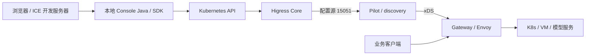

# Higress Console 本地开发与全链路调试

> 适用范围：公司内部学习与开发环境。2026-11-01 按本地 `higress-console@deffd9b`、`higress@eb507bf` 源码核对。本文命令是操作教程，本次没有启动应用、变更集群或跑通 E2E，运行结果需自行记录。源码版本、Chart 版本与镜像版本应分别登记，不能仅凭 Chart 版本认定源码一致。

## 1. 先理解两条链路



Console 是管理面。页面保存成功只能说明 API 调用成功，不代表网关已经接收配置。业务请求不会经过 Console，也不会同步经过 Core/Pilot；控制面通过异步事件和 xDS 下发配置。

建议按难度逐级开展：

1. **Console 本地、Core/Pilot/Gateway 在开发集群**：做页面、Java API、SDK 转换开发。
2. **再把 Core 放到本地**：调试 Ingress、WasmPlugin、服务发现等转换。
3. **最后把 Pilot 放到本地**：调试 LDS/RDS/CDS/EDS 生成与下发。
4. Envoy 或插件代码需要单独调试方式，不能用 Java/Go 断点跟进 Envoy C++ 或 WASM 指令。

第 2～4 级见 [Higress 本地开发与调试](../../../higress/docs/walmart/local-development-debugging.md)。两个仓库按下一节的布局并排存放。

## 2. 目录、工具与开发集群

```text
teaho-infra/
├── higress-console/       frontend + backend/sdk + backend/console
└── higress/               Core + Pilot + Gateway + plugins
```

本机源码目录：`/home/teaho/IdeaProjects/teaho-infra/higress-console`。本文 Shell 示例使用 Bash。每个新终端重新设置变量：

```bash
export CONSOLE_REPO=/home/teaho/IdeaProjects/teaho-infra/higress-console
export HIGRESS_REPO=/home/teaho/IdeaProjects/teaho-infra/higress
export DEV_KUBECONFIG="$HOME/.kube/higress-dev.yaml"
export HG_NS=higress-system
export KUBECONFIG="$DEV_KUBECONFIG"
```

`DEV_KUBECONFIG` 是你准备的、只包含开发集群上下文的文件，不是仓库自带文件。不要把生产 kubeconfig 或密钥放进 Git。

```bash
kubectl config current-context
kubectl --request-timeout=10s cluster-info
kubectl -n "$HG_NS" get deploy,pod,svc
kubectl get ingressclass
kubectl -n "$HG_NS" auth can-i create ingresses.networking.k8s.io
kubectl -n "$HG_NS" auth can-i update configmaps
```

前提是该独立开发集群已安装版本匹配的 Higress 和 CRD。安装/镜像准备延用 [构建学习指南](build-learn.md) 及 Higress 仓库的企业镜像文档。不要为了调试重新安装到共享或生产集群。Console 会写入资源和初始化配置，开发账户需要实际使用到的 Ingress、ConfigMap、Secret、WasmPlugin 等权限。

### 工具版本的真实依据

| 工具 | 本地代码依据与选择 |
|---|---|
| Java | `backend/pom.xml` 使用 Spring Boot 2.7.18，`java.version=1.8` 是依赖/编译基线。开发建议先用 JDK 17，与 IDE/Maven 保持一致；企业镜像另有 JDK 21 基础，需分别验证 |
| Node | `backend/console/pom.xml` 固定 16.19.0，但前端包含较新的依赖。先检查锁文件与依赖 engines，不把旧博客的“Node ≥16”当作所有新依赖都兼容的保证 |
| 包管理 | Maven 前端插件执行 npm；仓库同时有 yarn.lock，且本机已有未提交修改。不要在 npm/yarn 间反复切换或覆盖锁文件 |
| Kubernetes | 需要 kubectl、Helm 与可访问的开发集群；调试主机要能访问 API Server |

先执行 `java -version`、`node --version`、`npm --version`、`cd "$CONSOLE_REPO/backend" && ./mvnw -version`。本次未执行依赖安装。遇到 Node engines 冲突时，按团队批准的 Node 版本验证并同步 Maven 的 `nodejs.version`，不要只在个人终端升级。

## 3. 启动后端：先通 API，再联调页面

### 3.1 转发 Pilot 的查询端口

在独立终端保持运行：

```bash
kubectl -n "$HG_NS" port-forward --address 127.0.0.1 deployment/higress-controller 15014:15014
```

这里 `15014` 是 Controller Pod 内 **discovery/Pilot** 的监控及查询端口，不是 Core 的 `8888` HTTP 端口，也不是 `15051` 配置源端口。Console 的部分服务查询依赖此端口，资源写入则走 Kubernetes API。

### 3.2 在 IntelliJ IDEA 启动

1. 打开 `backend/pom.xml`，导入 SDK 与 Console 两个 Maven 模块，设置 JDK 17。
2. 启动类：`com.alibaba.higress.console.HigressConsoleApplication`。
3. 使用 Console 模块 classpath。Working directory 设置为 `higress-console/backend` 的绝对路径。
4. Run Configuration 填入以下环境变量，路径必须展开成真实绝对路径，IDE 不一定展开 `$HOME`：

```text
HIGRESS_CONSOLE_KUBE_CONFIG=/home/teaho/.kube/higress-dev.yaml
HIGRESS_CONSOLE_NS=higress-system
HIGRESS_CONSOLE_CONTROLLER_SERVICE_HOST=127.0.0.1
HIGRESS_CONSOLE_CONTROLLER_SERVICE_PORT=15014
```

Program arguments：

```text
--server.address=127.0.0.1 --server.port=8080
```

这些键来自 `backend/console/.../config/SdkConfig.java` 与 `constant/SystemConfigKey.java`。kubeconfig 决定实际集群，namespace 只限制相应资源位置，并不切换集群。

5. 使用 Debug 启动，等启动日志完成再打开 `http://127.0.0.1:8080/`。没有构建静态资源时根路径没有页面并不等于 API 没启动；可以观察 `/v1/routes` 返回值，401 表示需正常登录。
6. SDK 源码应来自当前 reactor 模块，避免 IDE 使用 Maven 缓存里的旧 SDK。

可选的命令行打包方式（下载依赖并触发前端构建，首次可能较慢）：

```bash
cd "$CONSOLE_REPO/backend"
./mvnw package -DskipTests -Dgpg.skip=true
```

生成 `console/target/higress-console.jar` 后，可用：

```bash
export HIGRESS_CONSOLE_KUBE_CONFIG="$DEV_KUBECONFIG"
export HIGRESS_CONSOLE_NS="$HG_NS"
export HIGRESS_CONSOLE_CONTROLLER_SERVICE_HOST=127.0.0.1
export HIGRESS_CONSOLE_CONTROLLER_SERVICE_PORT=15014
java -agentlib:jdwp=transport=dt_socket,server=y,suspend=n,address=127.0.0.1:5005 \
  -jar console/target/higress-console.jar \
  --server.address=127.0.0.1 --server.port=8080
```

IDE Remote JVM Debug 连接 `127.0.0.1:5005`。上述 JDWP 格式针对 JDK 17。`-DskipTests` 仅用于快速开发打包，不表示测试通过。无需执行 `backend/build.sh` 来调试 Java，该脚本还会构建镜像。

## 4. 启动前端：先改代理，防止操作演示站

当前 `frontend/ice.config.mts` 的 `/api` 代理目标仍为 `http://demo.higress.io/`。启动页面之前，把 **target 这一项**改成：

```typescript
proxy: {
  "/api": {
    target: "http://127.0.0.1:8080/",
    changeOrigin: true,
    pathRewrite: { "^/api": "" },
  },
},
```

这是你执行教程时需要做的本地修改，本文不会自动修改它。保留已有配置的其余部分。

```bash
cd "$CONSOLE_REPO/frontend"
# 使用团队选定的包管理器。当前 Maven 的安装命令为 npm install。
npm install
npm start
```

打开终端打印的 ICE 地址（不要把开发服务器端口写死）。检查浏览器 Network：

```text
浏览器 /api/v1/routes
  经 ICE proxy 去掉 /api
本地 Java /v1/routes
```

`frontend/src/services/request.tsx` 在开发模式下设置 `/api` baseURL。页面代码改动通常热更新，代理目标变更需重启开发服务器。通过本地页面完成初始化/登录，保留同一 hostname 访问，避免 localhost 与 127.0.0.1 的会话混用。

不要把前端 API baseURL 改成跨域 Java 地址来绕过代理，也不要为了 401 关闭鉴权。需要重放请求时，用 Network 的 Copy as cURL，并把 URL 改为本地地址；不要将复制出的会话 token 写进文档或提交仓库。

## 5. 实战：修改一条路由并追踪到业务响应

### 5.1 最小测试场景

先在开发集群部署一个已批准的 echo/httpbin 测试服务（参考 Higress 的 `test/e2e/conformance/base/manifests.yaml`，或使用你们现成的开发服务）。确定 Service 名、命名空间、端口和 EndpointSlice 都正常。

在 Console 创建专用测试域名 `debug.gateway.test`，路由路径 `/debug`，选择测试后端。控制台具体字段以当前页面和 `frontend/src/interfaces/route.ts` 为准。避免手写过时 JSON，把页面实际提交的请求作为重放样本。

### 5.2 按以下顺序设置断点

| 层级 | 断点位置（相对 Console 仓库） | 观察内容 |
|---|---|---|
| 页面 | `frontend/src/pages/route/components/RouteForm/index.tsx` | 表单校验、路径、目标服务与权重 |
| API 封装 | `frontend/src/services/route.ts` 的 `addGatewayRoute` / `updateGatewayRoute` | 实际 payload 与 URL |
| Java API | `backend/console/src/main/java/com/alibaba/higress/console/controller/RoutesController.java` 的 `add` / `update` | 请求模型、校验异常 |
| SDK | `backend/sdk/src/main/java/com/alibaba/higress/sdk/service/RouteServiceImpl.java` 的 `add` / `update` | 转换前后 Route 与 Ingress |
| 模型转换 | 同一 SDK 包下 `service/kubernetes/KubernetesModelConverter.java` 的 `route2Ingress` | annotations、host、path、backend |
| K8s 写入 | 同目录 `KubernetesClientService.java` 的 `createIngress` / `replaceIngress` | namespace、ingressClass、API 返回码 |

用测试路由名称作为条件断点，尽量仅暂停当前线程。浏览器或代理超时后重新提交请求，不要把断点暂停导致的超时当成产品缺陷。

### 5.3 验证保存与下发

```bash
kubectl -n "$HG_NS" get ingress
# 替换为页面所建资源的实际名称，不一定等于显示名
export DEBUG_ROUTE=替换为实际Ingress名称
kubectl -n "$HG_NS" get ingress "$DEBUG_ROUTE" -o yaml
kubectl -n "$HG_NS" get pods
kubectl -n "$HG_NS" get deploy higress-controller \
  -o jsonpath='{.spec.template.spec.containers[*].name}{"\n"}'
```

接着按真实容器名查看 Core 和 discovery 日志。独立终端转发业务服务端口：

```bash
kubectl -n "$HG_NS" get svc higress-gateway
# 下面假定 Service 的 HTTP 端口是 80，以实际 get svc 结果为准
kubectl -n "$HG_NS" port-forward --address 127.0.0.1 svc/higress-gateway 18080:80
```

```bash
curl -sv -H 'Host: debug.gateway.test' \
  -H 'X-Request-ID: local-debug-route-001' \
  http://127.0.0.1:18080/debug
```

Host 匹配域名，`X-Request-ID` 用于数据面日志关联；它不会自动成为配置推送的关联 ID。管理链路用资源名称、resourceVersion、更新时间和 xDS 版本定位。依次收集：API 响应、Ingress 内容、Pilot 下发/ACK、Envoy config_dump、业务响应。

若 `/debug` 后端只支持 `/`，要明确配置 rewrite 或选择支持此路径的 echo 服务。网关匹配成功但上游返回 404，与网关未命中路由是两类问题。

## 6. 开发一项功能时改哪里

以“路由新增一个配置项”为例：

1. 前端 `interfaces/route.ts` 定义字段，RouteForm 加输入和校验，`locales/` 加中英文说明。
2. Java SDK `model/Route.java` 或 `model/route/` 加模型，Controller/SDK 验证默认值与兼容性。
3. `KubernetesModelConverter` 同时考虑 `route2Ingress` 和 `ingress2Route`，验证保存后重新打开不会丢字段。
4. 已有标准注解能表达时复用它；需要新的网关行为，再到 Higress Core 添加解析/转换。不要让 Console 保存一个 Core 不认识的字段。
5. 修改 AI 路由时跟踪 `frontend/src/services/ai-route.ts`、`AiRoutesController`、`AiRouteServiceImpl`，继续检查生成的路由和插件资源。模型密钥不要输出到调试日志。
6. 分别测试输入校验、模型双向转换、旧资源读取、网关实际行为，再执行仓库约定的 lint/测试。

```bash
cd "$CONSOLE_REPO/backend"
./mvnw -pl sdk -am test -Dgpg.skip=true
cd "$CONSOLE_REPO/frontend"
npm run eslint
npm run check-i18n
npm run build
```

Console 模块测试按实际测试类选择；完整 Maven 构建会触发前端步骤。不要用 `api-docs` profile 充当通用开发模式，该 profile 会跳过多项检查。

## 7. 问题定位与收尾

| 现象 | 首先检查 |
|---|---|
| 页面数据来自演示站 | `ice.config.mts` target、前端是否重启、Network 请求路径 |
| Java 8080 空白 | 是否仅缺少静态资源；前后端分离模式应访问 ICE 地址 |
| 401 / 登录循环 | 浏览器同源、会话、初始化状态；不要删除鉴权代码 |
| K8s 403 / timeout | kubeconfig 当前上下文、API 网络、实际资源 RBAC |
| 服务列表失败 | 15014 转发、Pilot 状态、Console controller host/port |
| 保存成功但无路由 | namespace/ingressClass、Core watch、Pilot ACK、Envoy RDS |
| 网关 503 | EndpointSlice、上游连通性、Consul intentions/mTLS/透明代理 |
| SDK 断点不命中 | reactor 模块依赖与 classpath，是否加载了旧 jar |

收尾：删除本次专用测试路由/域名/后端，关闭 Java、ICE 和 port-forward；仅撤销自己对代理 target 的修改，保留已有修改。若接管过 Core/Pilot，先按 Higress 教程恢复集群，再关闭本地进程。

## 8. 资料与验证记录

- [官方 Console 教程](https://higress.ai/blog/console-dev)，2024-03-02，作为入门背景。
- [官方 E2E 教程](https://higress.cn/blog/e2e-debug)，2023-12-19；当前源码已有分阶段测试，无需照搬注释测试代码的方法。
- [官方 Pilot 教程](https://higress.ai/blog/pilot-debug/)，2024-03-16；涉及认证绕过的部分不作为默认操作。
- [本地 Higress 全链路教程](../../../higress/docs/walmart/local-development-debugging.md)。

本文件位于 `<repo>/docs/walmart/`，到并排仓库的相对路径为 `../../../higress/docs/walmart/local-development-debugging.md`。

| 验证项目 | 本次状态 | 开发者实测记录 |
|---|---|---|
| 文件、类名、配置键与当前源码对照 | 已核对 | 提交号： |
| Console 前后端启动与登录 | 未执行 | JDK/Node、日期、结果： |
| 页面保存至网关生效 | 未执行 | 路由、资源版本、响应： |
| 单元测试与构建 | 未执行 | 命令、日志： |
| 公司 Connect K8s / VM 路径 | 待验证 | intentions、mTLS、后端证据： |
